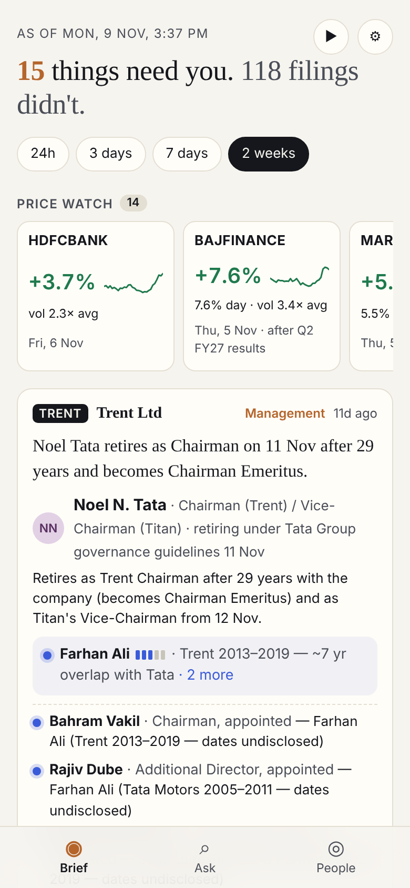
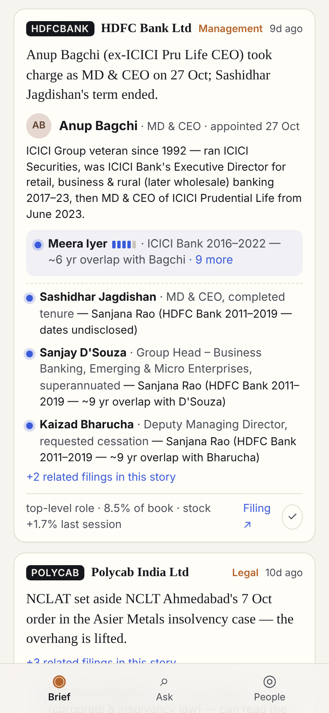
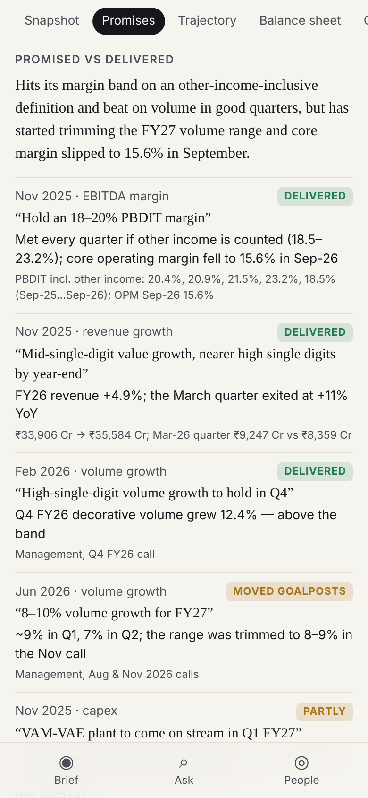
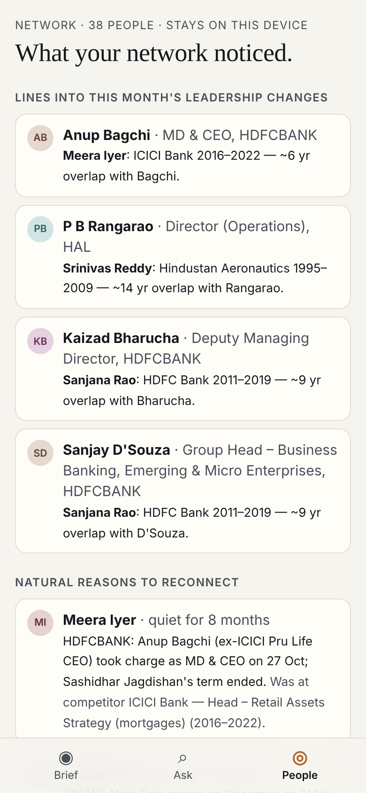
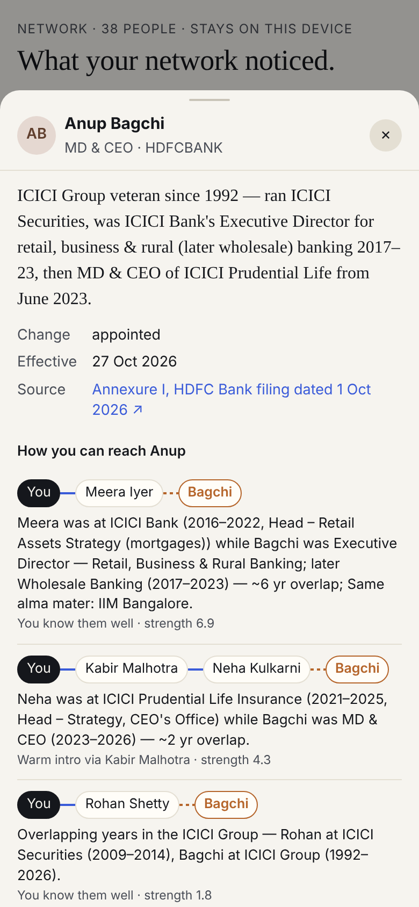

# FINN — a financial investment agent that filters, and knows who you know

FINN is a mobile-first agent for a public-markets investor. It works in three layers:

- **Brief (Push):** every exchange filing across the portfolio for a window you choose (24h by default), classified,
  scored and clustered into stories. At most five full cards; the rest is compressed into one-liners or filed away.
  End-of-day price and volume alerts run against *your* thresholds, on the phone.
- **Ask (Pull):** a research dossier on any NSE company, built only from primary sources (statements from filings,
  concall transcripts, annual reports): snapshot, trajectory, balance sheet, cash quality, **promised vs delivered**,
  narrative vs numbers, bull vs bear.
- **People (Network):** your own network, matched against the people and companies in the news, on your device.
  It shows who worked with an incoming CEO, a warm-intro path when you only have a weak tie, who to call about a
  company (with a compliance flag if they're a current employee or at a competitor), your blind spots, and natural
  reasons to reconnect.

**Live:** `<your GitHub Pages URL>` · Architecture: [docs/architecture.md](docs/architecture.md) · Write-up: [WRITEUP.md](WRITEUP.md)

| Brief | Network on a card | Promised vs delivered | What your network noticed | Warm-intro paths |
|---|---|---|---|---|
|  |  |  |  |  |

## Repository

```
backend/finn/          Python: sources (BSE, NSE, screener, prices, PDFs), intel (classify, materiality,
                       results, people, fundamentals, transcripts, research), llm router, snapshot job, API
backend/tests/         tests against real captured payloads (no network, no model)
data/portfolio.json    mock portfolio (18 names) + research list
data/companies.json    org registry: aliases, groups, peers, suppliers, themes
data/network/          SYNTHETIC demo network (fictional people, real employers)
data/raw/              captured source payloads + build-time model outputs (llm_seed/)
web/                   React + Vite PWA (network matching lives in web/src/network.ts)
.github/workflows/     daily refresh (cron) and Pages deploy
```

## Run it locally

```bash
# backend (Python 3.11+)
pip install -r backend/requirements.txt
cd backend
FINN_OFFLINE=1 python -m finn refresh      # rebuild the snapshot from data/raw captures, no network needed
python -m pytest -q                        # 11 tests on real filings
export GEMINI_API_KEY=...                  # free key: https://aistudio.google.com/apikey
python -m finn refresh                     # live: prices, filings, fundamentals, LLM enrichment
python -m finn research DIXON              # one dossier for any NSE symbol
python -m finn serve                       # research API on :8000

# app
cd ../web && npm install
npm run dev                                 # http://localhost:5173
VITE_API_BASE=http://localhost:8000 npm run dev   # enables live Pull for any ticker
```

## Deploy (all free tiers)

1. **Push to GitHub** (public repo).
2. **App → GitHub Pages:** repo *Settings → Pages → Source: GitHub Actions*. Every push to `main` builds `web/` and
   publishes it (`.github/workflows/pages.yml`).
3. **Daily refresh:** add repo secret `GEMINI_API_KEY` (*Settings → Secrets and variables → Actions*). The
   `refresh-snapshot` workflow runs at 16:15 IST on weekdays; run it once by hand from the *Actions* tab.
4. **Live research API (optional):** on render.com, *New → Blueprint*, pick this repo (uses `render.yaml`), set
   `GEMINI_API_KEY`. Then add a repo *variable* `FINN_API_BASE` = the Render URL and re-run the Pages workflow.
   Without it the app still works on the pre-built dossiers.

## Notes

- The demo network is synthetic. To use a real one: *People → Import LinkedIn CSV* (your LinkedIn data export). It is
  stored only in the browser.
- The committed snapshot was built from real BSE filings, screener statements and concall transcripts as of
  9 Nov 2026. Its model-written parts (filing one-liners, people from annexures, guidance/promises for Asian Paints and
  Clean Science) were produced at build time with the same prompts and schemas (`data/raw/llm_seed/`); the first
  `refresh` with a Gemini key regenerates them.
