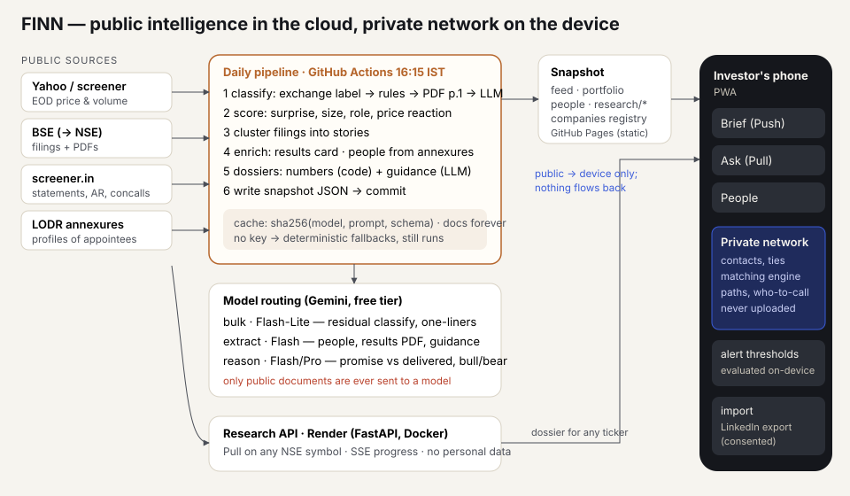

# FINN — architecture

The design rule that drives everything else: **public intelligence is computed on a server, but the
investor's network stays on their device.** The server never holds personal contacts, and no model
ever sees them.

## 1. Data pipelines

| Source | How it's fetched | Refresh | Stored as | Fallback |
|---|---|---|---|---|
| EOD price & volume | `yfinance` (`SYMBOL.NS`) | daily, 16:15 IST (after close) | `portfolio.json` (≈1 yr series) | screener.in chart endpoint |
| Filings / announcements | BSE corporate-announcements JSON API (the one bseindia.com itself calls) | daily + on demand | `feed.json` (filings + stories) | NSE `corporate-announcements` API, PDFs from `nsearchives.nseindia.com`. BSE's API answers 403 to GitHub-hosted runners, so the scheduled job usually runs on NSE; NSE rows are matched to their BSE twins (same company, ±20 min) to reuse BSE-keyed extracted text and profiles |
| Fundamentals | screener.in company page → standardised P&L, balance sheet, cash flow, ratios, shareholding + document links | 12 h cache | `research/<SYM>.json` | standalone page if no consolidated |
| Concall transcripts / annual reports | PDFs on BSE (links from screener) → `pypdf` text | immutable → cached forever | `data/cache/text/` | — (scanned PDFs: OCR is a to-do) |
| People in filings | the filing's own LODR "brief profile" annexure → `extract` model | per filing | `people.json` | licensed profile provider (see §2) |

**Linking things together**
- *Filing → company*: by BSE scrip code / NSE symbol (`data/portfolio.json`).
- *Filing → event*: classification (below), then **story clustering** — five Jio-IPO filings or four
  NCLAT updates become one story, so the feed shows events, not paperwork.
- *Filing → person*: names + roles extracted from the annexure; the person's career rows carry
  `org_id`s resolved through an org registry (`data/companies.json`: aliases, groups, peers,
  suppliers, customers, themes).
- *Person ↔ network*: on the device, by `org_id` + overlapping tenure, group membership
  (e.g. "ICICI Group since 1992"), and school + years. Every match keeps its evidence so the app can
  say *why* ("at ICICI Bank 2016–22 — ~6 yr overlap with his ED tenure").

**Classification & materiality (the filter)**
1. BSE's own sub-category label → reference category (≈68% of filings).
2. Keyword rules on subject + headline, with LODR boilerplate stripped first
   ("…not debarred … by any SEBI order" used to look like litigation) (≈27%).
3. Opaque titles ("Disclosure under Regulation 30") → read page 1 of the PDF and re-run the rules.
   This is how a Navin Fluorine filing turned out to be a 4-year extension of a $410M contract, and a
   Bajaj Finance "Issue of Securities" turned out to be routine ESOP plumbing.
4. Only what's still unresolved (≈5%) goes to the cheapest model, 40 filings per call.

Scores then depend on context, not just category: results are re-scored by their own surprise
(profit swing, margin shock, quality flags — no consensus data needed); an order is judged against the
company's revenue (a "Significant" L&T order (₹1,000–2,500 Cr) is 0.3–0.8% of its revenue → routine); a management change is
scored on the *role of the person named in the annexure*; a shareholder vote confirming an
earlier appointment is demoted; board-meeting notices are calendar items. Tiers: *needs you* (≥60),
*worth a glance* (30–59, one-liner), *routine* (collapsed). The app adds the investor's own
boosts/mutes and a network-relevance nudge on-device.

## 2. Security & privacy

- **The network never leaves the device.** It is stored in the browser (IndexedDB/localStorage in this
  prototype) and all matching — overlaps, warm-intro paths, who-to-call, expertise map, reconnect nudges —
  runs in `web/src/network.ts`. The server and the models only ever see public documents.
- **What FINN stores about people.** Contacts: what the investor imports (name, employers, schools,
  how they met, last-contact date). People in filings: only what the filing discloses, with the source.
  No scraped profiles.
- **Getting the network in, legitimately.** The investor's own LinkedIn data export
  (*Settings → Get a copy of your data → Connections*) imports directly (People → Import LinkedIn CSV),
  plus their calendar/CRM for "last spoke". That's consented and within LinkedIn's terms, unlike scraping.
  For people named in filings with no annexure profile, a *licensed* people-data provider would be called
  with the public name + company only — never with the contact list.
- **Real deployment.** Per-user encryption keys (passkey-derived); an encrypted sync blob so the server
  stores ciphertext only; per-user tenancy; contacts retained until the user deletes them (one-tap wipe,
  and auto-expiry of interaction logs after 24 months); audit log of every export; consent screen naming
  each source before import. People-in-filings data is public and retained with its filing.
- **Compliance built into the product.** Who-to-call flags current employees ("stick to public information")
  and people now at a competitor ("avoid anything confidential") — the MNPI line an investor actually worries about.
- The demo network is **synthetic**: fictional people with real employers, so overlaps with real filings can be shown.

## 3. LLMs and agents

| Step | Tier → fallback | Why this model | Calls per day (21 stocks) |
|---|---|---|---|
| Residual classification (~5% of filings) | `bulk` — Flash-Lite | cheap, fast; 40 filings per call | 1 |
| One-liners for stories worth a glance | `bulk` — Flash-Lite | short prose, batched 25/call | 1–2 |
| People from filing annexures | `extract` — Flash-Lite | structured JSON; names/orgs not in the filing are dropped | 0–5 |
| Guidance from transcripts | `extract` — Flash-Lite | per transcript, **pre-filtered to management answers with forward-looking cues (~15% of the text)**; every quote verified against the transcript | 5 per new dossier, cached forever |
| Business mix, bull/bear | `extract` — Flash-Lite | over the deterministic facts only; bullets citing figures not in the facts are flagged | 2 per new dossier |
| Promise vs delivered | `reason` — Flash → Flash-Lite | judgment over *verified* guidance + reported numbers, never raw transcripts; verdicts without figures become "unknown" | 1 per new dossier |

Why this routing (learned from the first live refresh, 10 Nov 2026): on the free tier, Flash allows ≈20
requests per **day** and was returning 503 (overloaded); a first refresh needs ~180 calls. So the volume
runs on Flash-Lite (≈500/day), Flash is capped at 15 requests per run, and every tier falls back to Flash-Lite.
Gemini 3 defaults to deep thinking and is documented to loop at low temperatures, so FINN sends
`thinkingLevel: low`, leaves temperature at the model default, and caps output tokens.

Reliability rules (`backend/finn/llm.py`): ≤ 1 + 2 attempts per model with a 90 s timeout and jittered backoff;
per-day 429 / 404 / 403 retire a model for the run; per-minute 429 honours `retryDelay`; 3 consecutive
failures open a 10-minute breaker; a 50-minute run budget after which remaining work is **deferred**
(labelled in the app, picked up next run from the cache). Every call returns ok / cached / failed /
deferred / unavailable — nothing incomplete is presented as analysed.

- Everything arithmetic (QoQ/YoY, margins, CAGRs, D/E, working-capital days, cash conversion, alerts) is
  deterministic code — models only read prose.
- Every successful call is cached by `sha256(prompt, schema)`; filings and transcripts never change, so a
  re-run costs ~0 tokens. Failures are never cached. A usage ledger and run report go to `meta.json` and
  the Actions step summary each run.
- No key → the pipeline still runs end to end with deterministic fallbacks (cleaned headlines, numbers-only
  dossiers); dossiers with a build-time seed show it, labelled "build-time analysis" with its generator.
- **Agentic behaviour** is deliberately narrow: the Pull pipeline plans which documents to read
  (latest 5 transcripts, filtered), calls tools (fetchers, parsers), and streams its progress. It never acts
  on the investor's behalf (no messages sent, nothing posted); drafting an outreach note is a suggestion the user sends.
- Pull is grounded in primary sources only: statements built from filings, transcripts, annual reports.
  Prompts forbid outside knowledge; every promise/verdict carries the quote and the numbers used.

## 4. Cloud

| What | Where | Why |
|---|---|---|
| Daily pipeline | GitHub Actions cron (16:15 IST, Mon–Fri) | free, has open internet, caches `data/cache` between runs; commits the snapshot |
| Mobile web app (PWA) | GitHub Pages (static) | free, instant on a phone, works even if the API sleeps |
| Live research API (any NSE symbol) | Render free web service (Docker) | runs Python (PDF parsing, yfinance), SSE progress; cold start ~30 s, so the app ships pre-built dossiers |
| Models | Google AI Studio (Gemini) free tier | Flash-Lite for volume, Flash (capped) for judgment, automatic fallback; on a paid key set `FINN_MODEL_EXTRACT=gemini-flash-latest` / `FINN_MODEL_REASON` to a Pro model |
| Private network | the investor's device | privacy by construction |

At scale: Postgres for filings/stories, object storage for PDFs, a queue (Cloud Tasks) for per-filing
enrichment triggered by the exchange feed every few minutes, and web push (VAPID) for triggered alerts.
